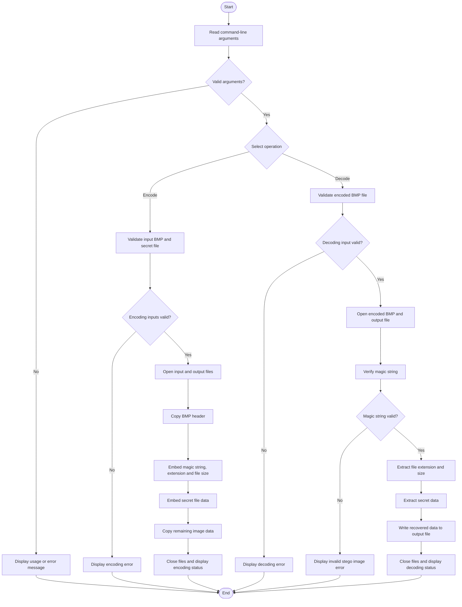

# BMP Steganography Encoder/Decoder using C++

## 📌 Overview

This project implements **LSB (Least Significant Bit) based image steganography** using C++. It hides secret data inside a 24-bit BMP image without making noticeable changes to the original image.

The encoder embeds a secret file into the image by modifying the least significant bits of the image's pixel data. The decoder extracts the hidden data and recreates the original secret file.

## 🎯 Problem Statement

To develop a C++ application that securely hides secret files inside BMP images using the Least Significant Bit (LSB) technique and retrieves the hidden information without visibly affecting the image.

## 🛠️ Technologies Used

- **Programming Language:** C++
- **Operating System:** Linux (Ubuntu)
- **Compiler:** GCC (G++)
- **Editor:** VS Code / Vim
- **Version Control:** Git and GitHub

### Concepts Used

- File handling
- Bitwise operations
- Pointers and arrays
- Binary file processing
- Command-line arguments
- Modular programming
- Error handling

## 📂 Project Structure

```text
BMP-Steganography/
│
├── beautiful.bmp
├── secret.txt
├── stego.bmp
├── decoded.txt
│
├── common.h
├── encode.cpp
├── encode.h
├── decode.cpp
├── decode.h
├── main.cpp
│
└── README.md
```

- **common.h** – Contains common definitions, constants, and enumerations.
- **encode.cpp** – Implements the encoding process.
- **encode.h** – Contains encoding-related structures and function declarations.
- **decode.cpp** – Implements the decoding process.
- **decode.h** – Contains decoding-related structures and function declarations.
- **main.cpp** – Handles command-line arguments and selects the operation.

## ⚙️ Working Principle

### 1. Encoding

The encoder hides the secret file inside a 24-bit BMP image.

The encoding process involves:

1. Opening the source BMP image and secret file.
2. Copying the BMP header into the output image.
3. Embedding the magic string `#*` to identify the presence of hidden data.
4. Embedding the secret file extension.
5. Embedding the secret file size.
6. Embedding the secret file contents.
7. Copying the remaining image data into the output image.

### 2. Decoding

The decoder extracts the hidden information from the encoded BMP image.

The decoding process involves:

1. Opening the encoded BMP image.
2. Reading and verifying the magic string `#*`.
3. Extracting the secret file extension.
4. Extracting the secret file size.
5. Extracting the secret file contents.
6. Creating a file containing the recovered data.

## 🔄 Programming Flow

The following flowchart shows the overall program execution, including operation selection, encoding, decoding, and error handling.



## ▶️ How to Compile and Run

### Step 1: Compile the program

```bash
g++ *.cpp -o steganography
```

### Step 2: Encode a secret file

```bash
./steganography -e beautiful.bmp secret.txt stego.bmp
```

This command hides `secret.txt` inside `beautiful.bmp` and generates `stego.bmp`.

### Step 3: Decode the secret file

```bash
./steganography -d stego.bmp decoded.txt
```

This command extracts the hidden data from `stego.bmp` and saves it in `decoded.txt`.

**Note:** The commands assume that `main.cpp` supports the `-e` and `-d` options in this format.

## 📤 Sample Output

### Encoding Output

```text
INFO: Encoding Procedure Started 
INFO: Opening required files
INFO: Encoding magic string
INFO: Encoding secret file extension
INFO: Encoding secret file size
INFO: Encoding secret file data
INFO: Encoding Completed Successfully 
```

### Decoding Output

```text
INFO: Decoding Procedure Started 
INFO: Opening encoded image
INFO: Decoding magic string
INFO: Decoding secret file extension
INFO: Decoding secret file size
INFO: Decoding secret file data
INFO: Decoding Completed Successfully 
```


## ⚠️ Challenges Faced

- Understanding the BMP file format and its header structure.
- Manipulating individual bits using bitwise operations.
- Embedding secret data without visibly affecting the image.
- Extracting the correct amount of data during decoding.
- Handling binary files and validating input data.
- Debugging file operations and error conditions.

## ✅ Result

The project successfully demonstrates how a secret file can be embedded inside a BMP image using the LSB technique and recovered through decoding.

The approach preserves the image's general visual appearance while allowing the hidden data to be retrieved.

## 🚀 Future Enhancements

## 🚀 Future Scope

- Support PNG and JPEG formats.
- Encrypt secret messages before embedding.
- Add password protection.
- Support PDF, audio, and video files.
- Develop a GUI.
- Increase data embedding capacity.
- Optimize performance for larger files.
  
## 👩‍💻 Author

**Shaik Shabeena**

Electronics and Communication Engineering (ECE)

**Email:** skshabeena33@gmail.com

**LinkedIn:** https://www.linkedin.com/in/shaik-shabeena-36a7b9332/
